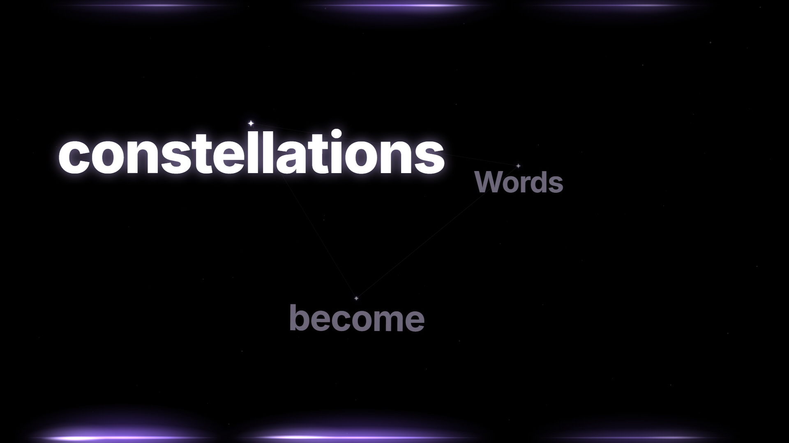
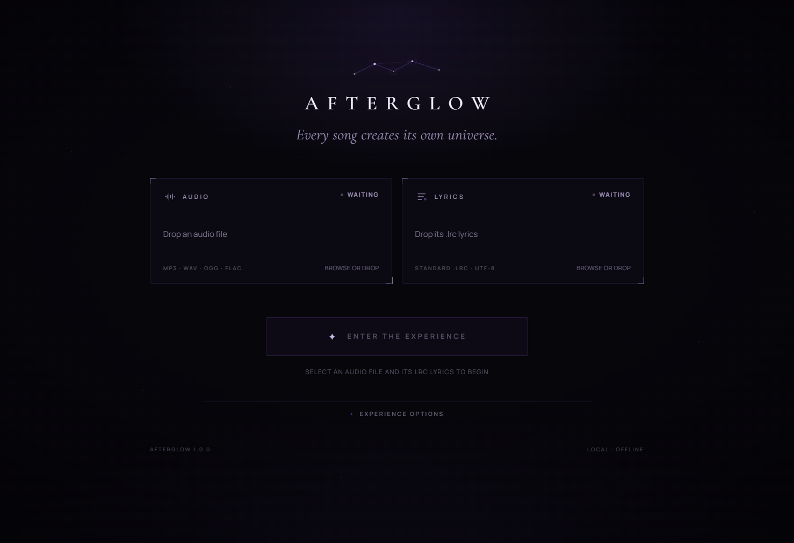
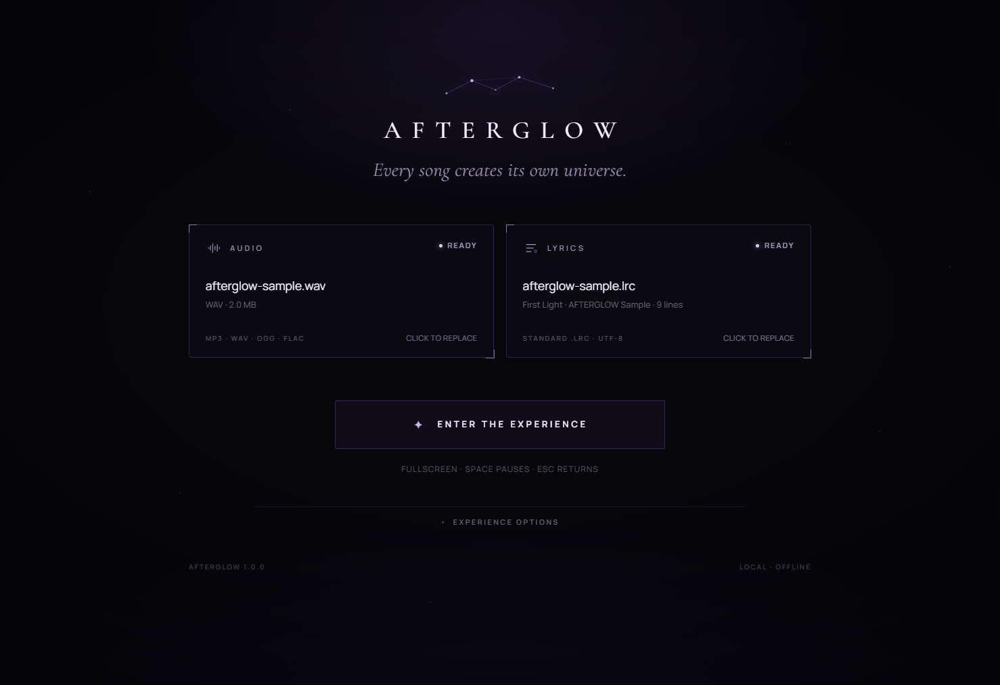
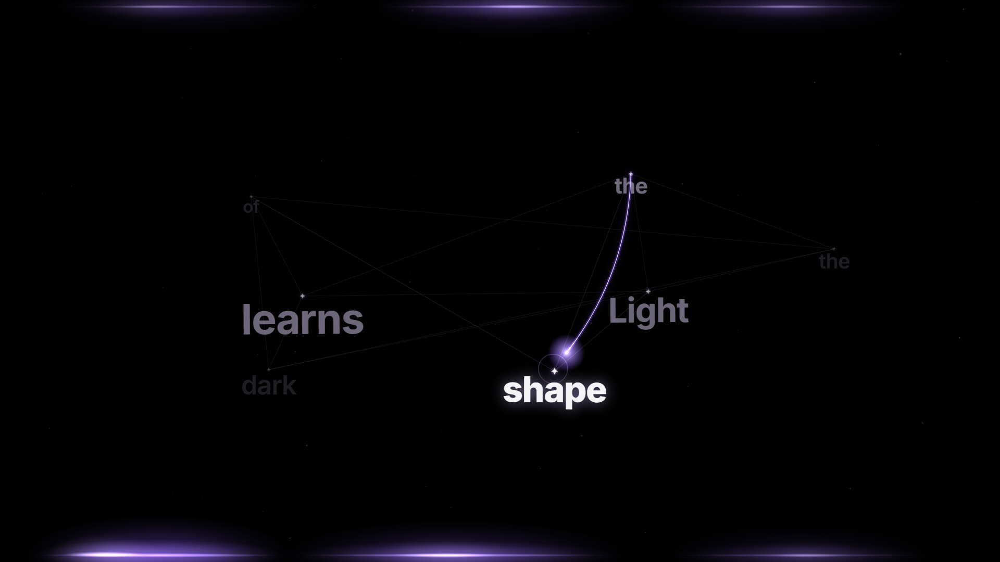
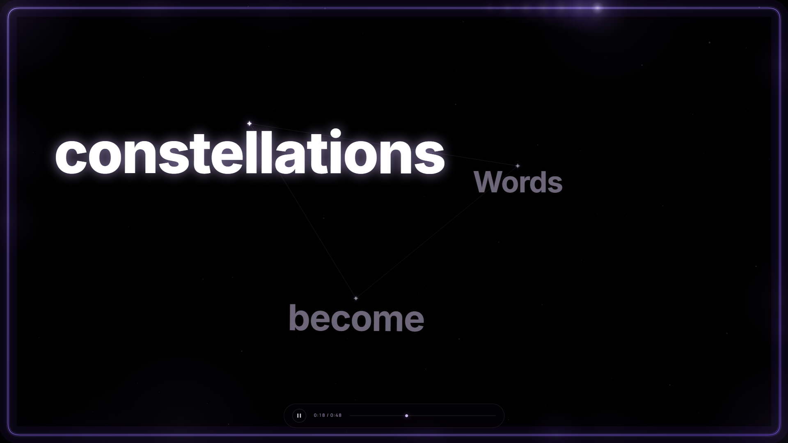

# AFTERGLOW

**Every song creates its own universe.**

AFTERGLOW is a local, offline Windows desktop app that turns an audio file and its timestamped LRC lyrics into a fullscreen constellation-typography experience. There is no player chrome in the experience: no progress bar, artwork, playlist, sidebar, or watermark. Just the song, the words, and the map they make.

## Download

No build tools needed. Grab the latest build from [**Releases**](https://github.com/Pxjjuzz/AFTERGLOW/releases/latest):

- **AFTERGLOW-1.0.1.Setup.exe** — recommended. Download, run it, and AFTERGLOW installs to your user profile with a Start Menu shortcut. No admin rights needed.
- **AFTERGLOW-win32-x64-1.0.1.zip** — portable. Extract anywhere and run `afterglow.exe`.

The build is unsigned, so Windows SmartScreen may show *"Windows protected your PC"*. Choose **More info**, then **Run anyway**.



## What it is

- Pick one audio file and one `.lrc` file, or drop them onto the two doorway panels.
- Press **ENTER THE EXPERIENCE**. AFTERGLOW loads the audio, enters true Windows fullscreen, and begins constellation typography.
- Words in the current line become a deterministic star map. Edges draw progressively, the spoken word glows, completed words settle, and upcoming words wait in the dark.
- When the lyric moves on, a slow comet draws a curved path from the previous word's star to the next one, with a bright head, a hairline trail, and a soft ring where it lands. Word brightness is animated continuously instead of snapping between states.
- The stage is true black, framed by a breathing violet edge light, with a slow comet travelling the bezel so the ambient glow never sits still while the song plays or rests.
- Lyrics use bold Inter (an SF-style face) scaled by word length: long words become planets, short words stay specks, and only the active word burns white.
- Three arrangements: **Constellation** (default), **Starfield**, and **Kinetic**.
- Leave with **Escape**. Both files, playback position, and settings remain on the doorway; entering again resumes the experience from the paused position.

It is not a music library. It is one doorway, one song, one universe at a time.

| Doorway | Ready to enter |
| --- | --- |
|  |  |

| Word-to-word handoff | Temporary controls |
| --- | --- |
|  |  |

## Requirements

- Windows 10 or 11, x64.
- Node.js 22 or newer and npm 10 or newer for development.
- A local audio file and a UTF-8 `.lrc` file.

The app has no network features. Audio and lyrics never leave the machine.

## Quick start

```powershell
npm install
npm run dev
```

To try it immediately, use the clearly labelled demo pair:

- `samples/afterglow-sample.wav` — an original synthesized ambient sketch generated for this project, not a commercial recording.
- `samples/afterglow-sample.lrc` — timed lyrics with enhanced word tags.

## In the experience

| Input | Action |
| --- | --- |
| **Space** | Pause / resume the authoritative audio clock |
| **← / →** | Seek backward / forward five seconds |
| **H** | Show or hide temporary controls (when enabled) |
| **Escape** | Leave fullscreen, pause, and return to the doorway |
| **Mouse movement** | Briefly reveals temporary controls, if enabled |
| **Windows exit fullscreen** | Returns to the doorway in a paused state |

Temporary controls fade away on their own. They are not persistent player chrome; with the option disabled, the stage contains only the canvas.

## LRC support

AFTERGLOW reads UTF-8 LRC text. Supported syntax:

```lrc
[ti:First Light]
[ar:AFTERGLOW Sample]
[al:Generated for the AFTERGLOW demo]
[length:00:48]
[by:AFTERGLOW]
[offset:0]

[00:00.00]<00:00.00>Every <00:00.60>song <00:01.10>creates
[00:05.00]Nothing here is in a hurry
[00:10.00][00:40.00]A repeated chorus line
```

- Line timestamps: `[mm:ss.xx]`, `[mm:ss.xxx]`, and `[mm:ss]`.
- Multiple timestamps on one line are expanded into separate timed lines.
- Enhanced word timestamps such as `<00:01.25>` are used when they line up with the words in the line. When a segment contains several words, the in-between word timings are approximated.
- Metadata is read from `[ti:]`/`[title:]`, `[ar:]`/`[artist:]`, `[al:]`/`[album:]`, `[by:]`/`[author:]`, and `[length:]`.
- `[offset:]` is applied to every line. Positive values delay the lyrics.
- Blank lines and lines without any timestamp are skipped with a warning; valid lines still load.
- Identical lyrics at the same timestamp are ignored. Different lyrics at the same timestamp are joined as `First / Second`, so repeated simultaneous lines remain stable and deterministic.
- Lines are sorted by timestamp, then source order. Output IDs are stable across runs.
- A UTF-8 BOM is stripped. There is no encoding auto-detection; non-UTF-8 files may display replacement characters.

The **Lyric offset** setting is separate from the file tag. Positive milliseconds delay the lyrics relative to the audio. Both offsets are clamped to safe ranges.

## Audio support

The picker accepts `.mp3`, `.wav`, `.ogg`, `.oga`, `.flac`, `.m4a`, `.aac`, and `.webm`, up to 500 MB per file. Playback support ultimately depends on the codecs shipped with the Electron build. WAV, MP3, OGG, and FLAC work with the bundled Electron runtime; some M4A/AAC files can be rejected if the codec is unavailable. Unsupported or damaged files surface a readable error instead of a silent failure.

## Security and architecture

```
renderer (React, Zustand, Canvas 2D, GSAP)
        │  narrow typed API via contextBridge
preload (no Node integration)
        │  validated IPC
main process (Electron, native dialogs, fullscreen, SQLite, media protocol)
```

- `contextIsolation: true`, `nodeIntegration: false`, `sandbox: true`.
- The preload exposes only the typed `AfterglowApi` surface: pick/validate/read lyrics, prepare/release a media token, enter/exit fullscreen, and load/save settings.
- Renderer paths are never trusted directly. Main resolves canonical absolute paths, checks extensions, size, readability, and file type before returning a descriptor.
- Audio is served through a token-gated `afterglow-media://` protocol with `Range`/`206` support. The renderer never receives a raw filesystem handle.
- Navigation, new windows, webviews, and all permission requests are blocked.
- Production CSP is strict and injected at build time. Development CSP allows only the local Vite HMR socket.
- Fullscreen uses the native Electron window API. Escape and OS-level fullscreen exit both return to a paused doorway; a power-save blocker is released on exit.
- Settings and recent files are stored in a real SQLite database at `%APPDATA%\AFTERGLOW\afterglow.sqlite`, handled by `sql.js` with embedded WASM to avoid native rebuilds. Corruption is isolated and the app starts with defaults rather than failing to launch.
- The packaged app uses Electron fuses: no `RunAsNode`, no `NODE_OPTIONS`, no CLI inspect arguments, ASAR integrity validation, and ASAR-only app loading.

## Project layout

```
electron/          main process, preload, IPC, validation, media protocol, SQLite
shared/            one shared IPC contract and settings types
src/app/           doorway orchestration
src/components/    setup and experience UI
src/features/      LRC parser, lyric timeline, layout, canvas renderer
src/services/      authoritative HTMLAudioElement clock
src/stores/        Zustand app and playback state
src/styles/        design system
tests/unit/        parser, timeline, layout, metrics, validation, store, SQLite, audio
tests/e2e/         real Electron source run and packaged Windows app smoke test
scripts/           sample and icon generation
samples/           labelled generated demo pair
docs/              screenshots used above
```

## Development commands

```powershell
npm run dev          # Electron Forge + Vite development app
npm run typecheck    # TypeScript, no emit
npm run lint         # TypeScript + ESLint
npm test             # Vitest unit and integration tests
npm run test:e2e     # Package, then Playwright against source and packaged app
```

`npm run test:e2e` runs `electron-forge package` first. The Playwright suite launches the source Electron app with an isolated temporary user-data directory, stubs only the native file dialog, and asserts real fullscreen state, real audio playback, keyboard seeking, control visibility, file preservation, and re-entry. A second test launches `out/AFTERGLOW-win32-x64/afterglow.exe` through the Chrome DevTools protocol, restores files from SQLite inside the packaged app, plays the demo, enters fullscreen, and exits.

## Build and installer

```powershell
npm run package      # unpacked app in out/AFTERGLOW-win32-x64
npm run make         # Squirrel installer + ZIP in out/make
```

Artifacts:

- `out/AFTERGLOW-win32-x64/afterglow.exe`
- `out/make/squirrel.windows/x64/AFTERGLOW-1.0.0 Setup.exe` (~149 MB)
- `out/make/squirrel.windows/x64/afterglow-1.0.0-full.nupkg` (~148 MB)
- `out/make/squirrel.windows/x64/RELEASES`
- `out/make/zip/win32/x64/AFTERGLOW-win32-x64-1.0.0.zip` (~152 MB)

The installer is an unsigned local build. Windows SmartScreen may warn until the executable is code-signed. AFTERGLOW does not include an auto-updater.

## Demo assets

The sample pair is generated by:

```powershell
npm run generate:sample
```

`scripts/generate-sample.mjs` writes both files. The WAV is a quiet, original 48-second ambient chord study synthesized in Node. The LRC is timed to it and uses enhanced word tags. Nothing in the sample is copied from a commercial recording.

The application icon can be regenerated with:

```powershell
powershell -NoProfile -ExecutionPolicy Bypass -File scripts/generate-icon.ps1
node scripts/png-to-ico.mjs
```

## Verified in this build

Last verification run on Windows:

- `npm run lint` — passed (`tsc --noEmit` and ESLint, zero errors).
- `npm test` — **54 tests passed** across 8 test files.
- `npm run test:e2e` — **2 tests passed**: the source Electron workflow and the packaged Windows app.
- `npm run package` — succeeded.
- `npm run make` — succeeded; Squirrel `.exe`, `.nupkg`, `RELEASES`, and ZIP produced.
- `npm run dev` — Electron Forge launched the Vite renderer and the app window with no startup errors.

Environment used: Windows x64, Node 22.18.0, npm 11.17.0, Electron 45.2.1, Vite 8.3.5.

## Known limitations

- Windows-first. The code is Electron-portable, but packaging and verification in this repository target Windows x64.
- One audio file and one LRC file at a time. No playlists, libraries, folder scanning, or streaming.
- Synchronized lyrics only. Plain unsynchronized lyrics and embedded metadata in audio files are not read.
- UTF-8 LRC only. Legacy local encodings are not auto-detected.
- Enhanced word timings are approximate when one `<mm:ss.xx>` tag covers multiple words.
- The canvas typography bundles Latin Inter weights in an SF-style stack; other scripts fall back to system sans-serif fonts and may have different metrics.
- No waveform, spectrogram, translation, romanization, karaoke recording, themes beyond the three arrangements, or online lookup.
- The installer is unsigned, and no update feed is configured.
- `sql.js` writes the SQLite database by exporting and atomically replacing the file. It is a genuine SQLite database, but not a long-lived native SQLite connection shared with other processes.

## License

MIT. See [LICENSE](LICENSE).
